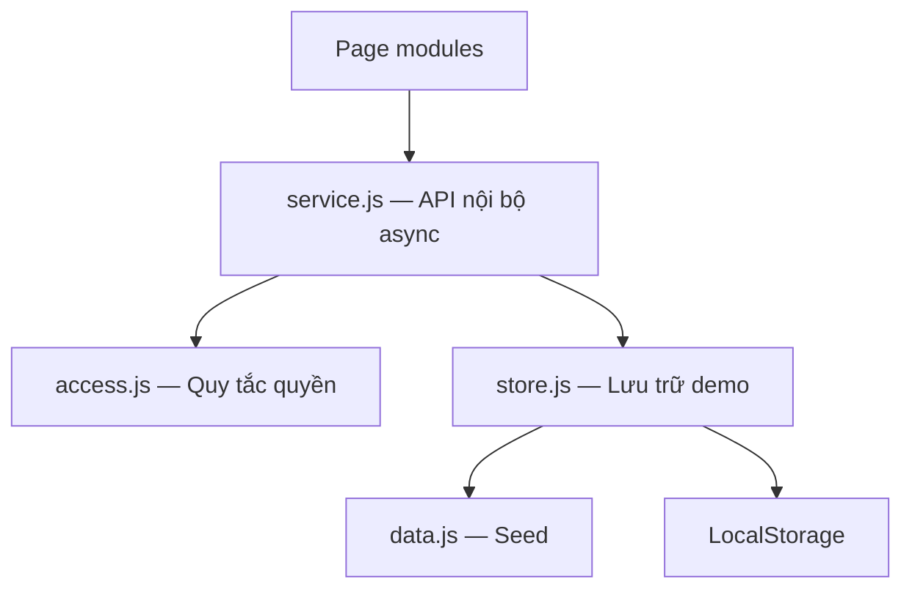

# School Camera Access Platform

**Quản lý quyền xem camera trường học theo từng phụ huynh và lớp học.**

School Camera Access Platform hướng tới thay thế cách chia sẻ tài khoản camera theo lớp bằng danh tính riêng cho mỗi phụ huynh. Quyền truy cập được xác định từ quan hệ phụ huynh–học sinh–lớp học, giúp nhà trường cập nhật quyền khi học sinh chuyển lớp hoặc nghỉ học.

**Giai đoạn:** Frontend MVP · **Phạm vi:** Một trường · **Công nghệ:** HTML5 / CSS3 / Vanilla JavaScript

[Repository](https://github.com/CaoXuanThanh/FE-developer) · [Kiến trúc](#kiến-trúc) · [Khởi chạy](#khởi-chạy) · [Đóng góp](#đóng-góp)

> Tài liệu thiết kế cho giai đoạn triển khai. Các tính năng mô tả bên dưới là phạm vi mục tiêu; chưa có bản phát hành hoặc Live Demo được xác minh. Frontend sử dụng dữ liệu và video mẫu, chưa kết nối hệ thống trường hoặc camera thật.

## Tổng quan sản phẩm

Khi cả lớp dùng chung một tài khoản camera, nhà trường khó thu hồi quyền của riêng một phụ huynh mà không ảnh hưởng những người còn lại. Dự án tập trung vào lớp quản lý danh tính và quyền truy cập, không thay thế hệ thống đầu ghi/NVR.

- **Phụ huynh:** truy cập danh sách con, lớp và camera phù hợp trong một portal thống nhất.
- **Nhà trường:** theo dõi quan hệ học sinh–phụ huynh, mô phỏng cập nhật lớp/trạng thái học và khóa quyền xem riêng từng phụ huynh.
- **Định hướng tích hợp:** duy trì ranh giới giữa giao diện, nghiệp vụ và dữ liệu để phát triển API và kết nối hệ thống hiện hữu ở giai đoạn sau.

Hiệu quả giảm thao tác quản trị và sai sót thu hồi quyền sẽ được đo trong pilot; chưa công bố số liệu tiết kiệm hoặc cam kết thương mại.

## Phạm vi MVP

| Phân hệ | Chức năng mục tiêu | Điểm vào |
| --- | --- | --- |
| Đăng nhập | Validation, đăng nhập demo, điều hướng theo role | `index.html` |
| Parent Dashboard | Thông tin con/lớp, danh sách camera động, tìm kiếm và trạng thái quyền | `pages/parent-dashboard.html` |
| Camera Viewer | Kiểm tra quyền, hiển thị camera, phát video mẫu và xử lý lỗi | `pages/camera-viewer.html` |
| Profile | Cập nhật tên hiển thị và thông tin liên hệ, validation, lưu dữ liệu demo | `pages/profile.html` |
| Admin Access | Tìm học sinh, xem quan hệ gia đình–lớp, cập nhật trạng thái và khóa/mở quyền PHHS | `pages/admin-access.html` |

LocalStorage lưu hồ sơ và trạng thái nghiệp vụ để dữ liệu còn sau khi tải lại trang. Danh sách được render từ mảng object; tìm kiếm dùng sự kiện `input`; các trang có trạng thái loading, empty, error và success phù hợp.

Ngoài phạm vi MVP: camera trực tiếp, playback lịch sử, Hikvision SDK, API trường, backend/database thật, đa trường, thanh toán và quản lý thiết bị đầy đủ. Video mẫu phải được gắn nhãn rõ trên giao diện.

## Mô hình quyền truy cập

Một phụ huynh có thể liên kết với nhiều học sinh; một học sinh có thể liên kết với nhiều phụ huynh. Mỗi học sinh đang học có một lớp hiện tại; mỗi camera thuộc một lớp trong MVP.

| Điều kiện hoặc thay đổi | Hành vi mong đợi |
| --- | --- |
| PHHS được mở quyền và có con đang học tại lớp A | Có quyền đối với camera lớp A |
| Nhiều con cùng một lớp | Camera được loại trùng theo ID |
| Một con chuyển từ A sang B | Tính lại quyền; vẫn giữ A nếu còn con khác đang học tại A |
| Không còn con đang học | Không có camera được phép xem |
| Admin khóa quyền PHHS | Chặn toàn bộ camera của PHHS đó; vẫn cho đăng nhập để xem thông báo/hồ sơ |
| Admin mở lại quyền | Tính từ quan hệ hiện tại, không khôi phục danh sách quyền cũ |
| Camera hợp lệ nhưng disabled/offline | Hiển thị trạng thái, không phát video |

Mặc định từ chối khi không có quan hệ hợp lệ. Profile không được sửa role, quyền, con hoặc lớp. Admin quản lý quyền nhưng không mặc nhiên được xem video của PHHS trong MVP.

Thao tác đổi lớp/nghỉ học trong Admin là mô phỏng dữ liệu đầu vào từ hệ thống trường. Quy tắc này cần được nhà trường xác nhận trước pilot.

## Kiến trúc

Giao diện gọi một hợp đồng service thống nhất. Nghiệp vụ quyền được tách khỏi DOM và lưu trữ để kiểm thử độc lập.



| Thành phần | Trách nhiệm |
| --- | --- |
| `js/data.js` | Dữ liệu mẫu và phiên bản dữ liệu; không ghi đè khi import |
| `js/store.js` | Khởi tạo, đọc/ghi và reset dữ liệu demo theo namespace |
| `js/access.js` | Hàm thuần tính quyền theo PHHS–học sinh–lớp–camera |
| `js/service.js` | API nội bộ trả Promise; kiểm tra phiên/role, validate và điều phối dữ liệu |
| `js/shared/session.js` | Kiểm tra phiên, điều hướng, đăng xuất và kiểm tra lại quyền qua service |
| `js/pages/` | Bắt sự kiện, gọi service, render DOM và trạng thái giao diện |
| `css/global.css` | Design tokens và thành phần dùng chung |

**Ranh giới bắt buộc:** page không đọc/ghi LocalStorage, không import seed và không sao chép thuật toán quyền. Service không thao tác DOM. Dữ liệu người dùng được render bằng DOM an toàn; không ghép trực tiếp vào HTML.

Các API chủ chốt: `login`, `getCurrentUser`, `getParentDashboard`, `getCameraView`, `getMyProfile`, `updateMyProfile`, `getAdminOverview`, `setStudentEnrollment`, `setParentAccess`, `logout`.

Hợp đồng chi tiết hiện nằm ở Phụ lục A của tài liệu phân công; khi khởi tạo source, chuyển vào `docs/data-contract.md` làm nguồn chuẩn duy nhất. Khi có backend, thay implementation phía sau service và giữ hợp đồng UI ổn định ở mức có thể. Backend phải thực thi quyền; thay `fetch()` đơn thuần chưa tạo ra hệ thống Production.

## Cấu trúc repository

Cấu trúc mục tiêu dưới đây chưa phải xác nhận tất cả file đã tồn tại trong repo.

| Đường dẫn | Nội dung |
| --- | --- |
| `index.html` | Login |
| `pages/` | `parent-dashboard.html`, `camera-viewer.html`, `profile.html`, `admin-access.html` |
| `css/global.css` | Style nền và CSS Variables |
| `css/pages/` | `login.css`, `parent-dashboard.css`, `camera-viewer.css`, `profile.css`, `admin-access.css` |
| `js/` | `data.js`, `store.js`, `access.js`, `service.js` |
| `js/shared/session.js` | Helper phiên và điều hướng |
| `js/pages/` | `login.js`, `parent-dashboard.js`, `camera-viewer.js`, `profile.js`, `admin-access.js` |
| `assets/images/`, `assets/media/` | Hình ảnh và video mẫu |
| `.skill/skill.md` | Quy tắc làm việc với AI được version cùng source |
| `.github/pull_request_template.md` | Checklist gửi PR; bổ sung khi thiết lập repo |
| `docs/PHAN_CONG_CONG_VIEC.md` | Ownership, task, quy trình Git và nghiệm thu |
| `docs/data-contract.md`, `docs/qa-checklist.md` | Hợp đồng dữ liệu và ca kiểm thử |
| `docs/prompt-logs/tv1.md` … `tv5.md` | Nhật ký AI theo thành viên |
| `docs/wireframes/`, `docs/evidence/` | Thiết kế và minh chứng |
| `PLAN.md`, `prompt_log.md`, `.gitignore` | Kế hoạch, tổng hợp prompt và quy tắc loại file khỏi Git |

## Khởi chạy

**Điều kiện:** repository đã có source MVP; máy có Git, VS Code, Chrome/Edge và HTTP server tĩnh như Live Server. Hướng dẫn này chưa phải xác nhận bản hiện tại của repo chạy được.

```bash
git clone https://github.com/CaoXuanThanh/FE-developer.git
cd FE-developer
```

Mở thư mục bằng VS Code, chạy `index.html` qua Live Server. ES modules cần được phục vụ qua HTTP; không mở bằng `file://`. Không cần backend nghiệp vụ hoặc bước build trong thiết kế hiện tại.

- **Tài khoản demo:** công bố khi seed được triển khai.
- **Live Demo:** bổ sung sau khi triển khai và kiểm tra URL.
- **Dữ liệu:** giữ cùng host/port; LocalStorage không tự đồng bộ giữa máy.
- **Phiên:** demo hai role tuần tự bằng đăng xuất/đăng nhập; chưa hỗ trợ nhiều phiên độc lập cùng origin.
- **Reset:** chỉ xóa namespace ứng dụng, không dùng `localStorage.clear()`; không seed lại trên mỗi lần tải trang.

## Chất lượng và kiểm thử

Một thay đổi chỉ hoàn thành khi đúng contract, qua review và chạy lại luồng liên quan sau merge.

- Kiểm tra ở 375 px và 1280 px; HTML semantic, label và focus bàn phím rõ.
- Không lỗi console chưa xử lý; form có validation và không lưu dữ liệu sai.
- Kiểm thử nhiều con, chuyển lớp, nghỉ học, khóa/mở quyền và loại trùng camera.
- Thử URL camera không được cấp quyền, missing ID, offline và video tải lỗi.
- Khi viewer nhận cập nhật mất quyền: dừng player, bỏ nguồn và hiện thông báo.
- Reload giữ thay đổi hợp lệ; seed không ghi đè dữ liệu đã chỉnh.

Bộ ca kiểm thử cụ thể nằm trong tài liệu phân công. Không gắn nhãn “tests passing” khi chưa có kết quả thực thi.

## Nhóm phát triển

| Thành viên | Vai trò | Phạm vi sở hữu |
| --- | --- | --- |
| **Cao Xuân Thành** | Team Lead / Product Owner / Core Developer; điều phối nhóm | Kiến trúc, dữ liệu, quyền, service, Admin, review và tích hợp |
| **Nguyễn Minh Thiên** | Frontend Developer | Parent Dashboard, danh sách động, tìm kiếm và responsive |
| **Lương Minh Đạt** | Frontend Developer | Login, validation và điều hướng |
| **Tất Huy Tuấn** | Frontend Developer | Camera Viewer, trạng thái phát và hỗ trợ demo |
| **Đào Nhựt Quang Minh** | Frontend Developer / QA | Profile, validation, kiểm thử và báo lỗi |

## Đóng góp

Quy trình nhóm: tạo nhánh từ `main` → thay đổi theo task → commit/push lên nhánh → mở PR → review → merge → kiểm thử bản tích hợp.

- `main` dành cho bản tích hợp chạy được; giữ nguyên nhánh bài tập cũ.
- Mỗi PR có phạm vi nhỏ, kết quả kiểm thử và prompt log liên quan.
- Thành phụ trách review/merge PR của thành viên. PR của Thành cần Thiên review để không tự duyệt.
- Chỉ người được giao sở hữu mới sửa core/global CSS; thay đổi hợp đồng phải được phối hợp trước.
- GitHub Projects theo dõi To-do / In Progress / Done. Done là đã kiểm thử và merge.

Cấu hình bảo vệ `main` và hướng dẫn từng bước nằm trong tài liệu phân công. Đây là quy trình đề xuất, chưa xác nhận đã được bật trên GitHub.

### Làm việc với AI

`.skill/skill.md` phải là file riêng trong repository, do Thành duy trì. Tài liệu phân công xác định người và task; file quy tắc AI xác định phạm vi sửa, công nghệ, contract, style và điều kiện kiểm tra. Tên đường dẫn này là quy ước nhóm, không bảo đảm mọi công cụ tự nạp.

Trước khi làm, thành viên đưa README, quy tắc AI, data contract và task hiện tại cho công cụ đọc; sau đó kiểm tra diff và chạy thử. Không coi kết quả AI là đã được review. Chưa tạo file `.skill/skill.md` trong bộ tài liệu bàn giao này.

**Prompt nổi bật:** sẽ chọn 3–5 prompt đã thực sự sử dụng từ `prompt_log.md`, kèm thay đổi và kiểm thử. Chưa có nhật ký triển khai được xác minh để công bố tại đây.

## Giới hạn bảo mật và lộ trình

Frontend mock không phải ranh giới bảo mật. Không đưa credential NVR, token thật hoặc dữ liệu trẻ em thật vào repo/LocalStorage. Hệ thống Production cần xác thực, kiểm tra quyền phía server và bảo vệ cả nguồn media; ẩn nút hoặc kiểm tra role ở trình duyệt là chưa đủ.

| Giai đoạn | Kết quả mục tiêu |
| --- | --- |
| Frontend MVP | Luồng người dùng hoàn chỉnh bằng dữ liệu/video mẫu |
| Backend & Database | API, phiên xác thực, quyền phía server, dữ liệu quan hệ |
| Integration | Xác minh API trường và thử nghiệm NVR được phép truy cập |
| Pilot một trường | Kiểm chứng vận hành, thu hồi quyền, chất lượng phát và chi phí |

Chưa xác minh endpoint/auth của API trường, model/firmware NVR, khả năng stream hoặc số người xem đồng thời. Chỉ quyết định mở rộng nhiều trường sau khi pilot chứng minh giá trị.

## Tài liệu dự án

Đặt README này tại gốc repository và file phân công tại `docs/PHAN_CONG_CONG_VIEC.md`. Các tài liệu còn lại được bổ sung trong quá trình triển khai; tránh liên kết giả hoặc placeholder thành tích.

Cơ sở thiết kế: `CAMERA_PROJECT_CORE_V2.docx`, giáo trình Thiết kế Web và quyết định của nhóm. Phần đối chiếu môn học, lịch luyện tập và hợp đồng chi tiết được giữ trong tài liệu phân công để README tập trung vào sản phẩm và cách tham gia dự án.
