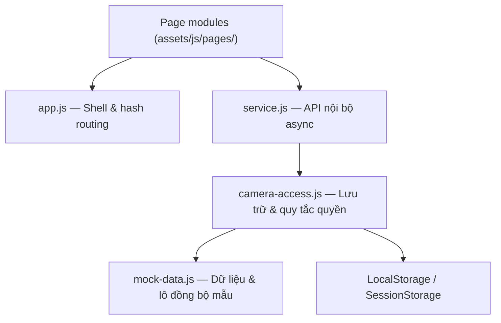

# School Camera Access Platform

**Quản lý quyền xem camera trường học theo từng phụ huynh và lớp học.**

Camera Access là ứng dụng frontend dành cho phụ huynh xem camera được cấp theo lớp của con đang học và quản trị viên theo dõi, đối soát quyền khi hồ sơ học sinh thay đổi. Ứng dụng chạy bằng **HTML5, CSS3 và Vanilla JavaScript** thuần, đi kèm dữ liệu, ảnh minh họa và video mẫu local.

[Repository](https://github.com/CaoXuanThanh/School-Camera-Access) · [Hợp đồng dữ liệu](docs/data-contract.md) · [Phân công công việc](docs/PHAN_CONG_CONG_VIEC.md) · [Quy tắc AI](.skill/skill.md)

## Chạy local

Mở [index.html](index.html) bằng Chrome hoặc Edge, hoặc chạy HTTP server tĩnh bằng Node.js để kiểm tra cập nhật quyền giữa nhiều tab trên cùng origin (`http://127.0.0.1:5500/`):

```sh
node tools/preview.cjs
```

### Tài khoản demo

| Tài khoản | Vai trò | Mô tả dữ liệu mẫu |
| --- | --- | --- |
| `admin` | Quản trị (`admin`) | Quản trị lớp, học sinh, camera, tài khoản demo, tra cứu và đối soát quyền |
| `trang@example.test` | Phụ huynh (`parent`) | Có 2 học sinh (`HS001` lớp `3A1`, `HS002` lớp `3A2`), được xem 3 camera gồm hành lang dùng chung |
| `nam@example.test` | Phụ huynh (`parent`) | Có học sinh `HS003` lớp `4A1`, camera sân sinh hoạt đang ngoại tuyến |
| `ha@example.test` | Phụ huynh (`parent`) | Liên kết `HS001` và `HS004` cùng lớp `3A1` (kiểm thử loại trùng camera & đồng phụ huynh) |

Mật khẩu chung cho các tài khoản mẫu là `CameraDemo26`. Ảnh minh họa (`assets/images/`) và video mẫu (`assets/media/`) được nạp local.

## Kiến trúc & Mã nguồn

Giao diện gọi hợp đồng Promise thống nhất qua `service`. Nghiệp vụ tính quyền và lưu trữ local được tách riêng khỏi DOM để kiểm thử độc lập.



| Thành phần | Vai trò |
| --- | --- |
| `index.html` & `assets/js/app.js` | Khung ứng dụng (portal shell), template và định tuyến hash theo vai trò |
| `assets/css/global.css` & `assets/css/portal.css` | Design tokens, component nền và layout cổng quản trị |
| `assets/js/mock-data.js` | Seed lớp, học sinh, phụ huynh, camera và lô đồng bộ hồ sơ mẫu |
| `assets/js/camera-access.js` | Lưu trữ local theo namespace, tính quyền theo lớp, xem trước tác động và đối soát |
| `assets/js/service.js` | Giao diện Promise cho mọi màn hình, kiểm tra phiên/vai trò, validate và sự kiện cập nhật quyền |
| `assets/js/legacy-link.js` | Điều hướng link tĩnh từ `pages/*.html` sang hash route tương ứng |
| `pages/admin-access.html` & `assets/js/pages/admin-access.js` | Cổng quản trị: tổng quan, học sinh & lớp, đối soát quyền, tra cứu quyền, danh mục camera, tài khoản demo, nhật ký |
| `assets/images/` & `assets/media/` | Ảnh minh họa và video mẫu dùng chung |

**Ranh giới bắt buộc:** page module không đọc/ghi `localStorage`, không truy cập trực tiếp seed và không tự tính quyền. Service không thao tác DOM. Trang chính khai báo CSP cho tài nguyên local và không chạy script inline.

## Phân công nhóm & Trạng thái tích hợp

Chi tiết task, tiêu chí nghiệm thu và quy trình Git nằm trong [docs/PHAN_CONG_CONG_VIEC.md](docs/PHAN_CONG_CONG_VIEC.md).

| Thành viên | Vai trò & Gói việc | Phạm vi file chính | Trạng thái |
| --- | --- | --- | --- |
| **Cao Xuân Thành (tv1)** | Team Lead / Core + Admin + tích hợp | Core (`mock-data.js`, `camera-access.js`, `service.js`, `app.js`, `legacy-link.js`), `global.css`, `portal.css`, `pages/admin-access.html`, `assets/js/pages/admin-access.js`, `assets/images/`, `assets/media/`, `docs/`, `.skill/skill.md`, `tests/unit.test.cjs` | Đã hoàn thiện nền tảng Core & Admin Access |
| **Nguyễn Minh Thiên (tv2)** | Parent Dashboard | `pages/parent-dashboard.html`, `assets/css/pages/parent-dashboard.css`, `assets/js/pages/parent-dashboard.js`, `docs/prompt-logs/tv2.md` | Chờ PR tích hợp |
| **Lương Minh Đạt (tv3)** | Login | `assets/css/pages/login.css`, `assets/js/pages/login.js`, `#login-template`, `docs/prompt-logs/tv3.md` | Chờ PR tích hợp |
| **Tất Huy Tuấn (tv4)** | Camera Viewer | `pages/camera-viewer.html`, `assets/css/pages/camera-viewer.css`, `assets/js/pages/camera-viewer.js`, `docs/prompt-logs/tv4.md` | Chờ PR tích hợp |
| **Đào Nhựt Quang Minh (tv5)** | Profile + QA | `pages/profile.html`, `assets/css/pages/profile.css`, `assets/js/pages/profile.js`, `docs/qa-checklist.md`, `docs/prompt-logs/tv5.md` | Chờ PR tích hợp |

> Khi các màn hình của TV2–TV5 chưa được merge, mở `index.html` sẽ hiển thị điểm vào Core để mở nhanh phiên `admin` kiểm thử đầy đủ Cổng quản trị (`#/quan-tri`). Khi từng thành viên merge PR định nghĩa hàm `renderLogin`, `renderParent`, `renderViewer`, `renderProfile`, `app.js` sẽ tự động kích hoạt màn hình tương ứng.

## Kiểm thử lõi quyền

Chạy unit test kiểm tra logic quyền, chuyển lớp, nghỉ học, khóa tài khoản và chống ghi đè dữ liệu cũ (`STALE_DATA`) bằng Node.js:

```sh
node --test tests/unit.test.cjs
```

## Video mẫu

- Lớp 3A1: [Pavel Danilyuk](https://www.pexels.com/video/an-empty-classroom-8342689/)
- Lớp 3A2: [Erkan Avanoğlu](https://www.pexels.com/video/empty-classroom-with-desks-and-tables-20421536/)
- Hành lang: [Joseph Park](https://www.pexels.com/video/empty-hallway-in-school-13008039/)
- Sân sinh hoạt: [James Cover](https://www.pexels.com/video/an-empty-playground-7009336/)

Các clip đi kèm theo [giấy phép Pexels](https://www.pexels.com/license/).
